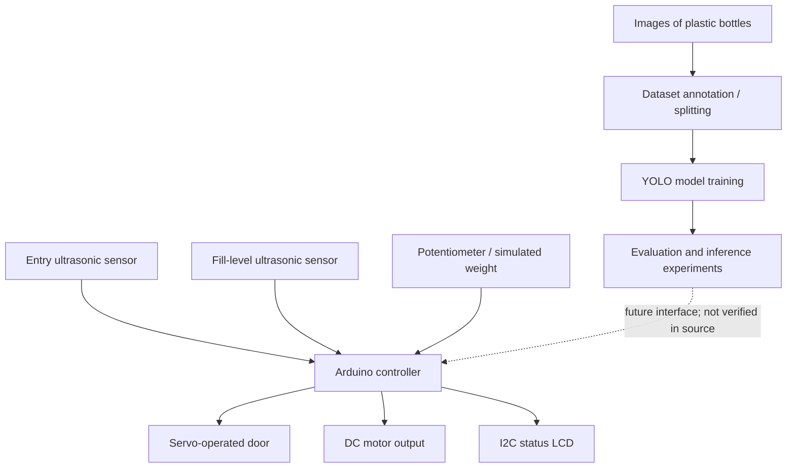
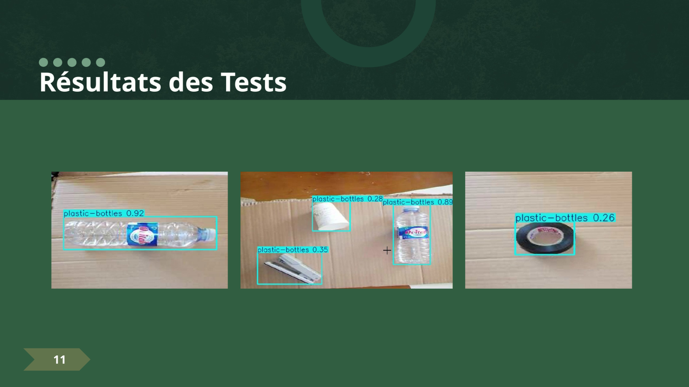

# EcoRecycle Smart Bin — Computer Vision & Embedded Systems

**Team QUARTZ — student project at École Nationale Polytechnique d'Oran (ENPO), Oran, Algeria · June 2025 · First-place hackathon team project**

A hands-on engineering prototype combining **plastic-bottle detection**, a custom annotated image dataset, and an **Arduino-based smart-bin controller** with ultrasonic sensing, door actuation and LCD feedback.

> **Scope and transparency:** This is a university hackathon prototype, not a commercially deployed recycling system. The supplied historic files document a vision-training experiment and a working Arduino *control design*, but do **not** establish a fully tested camera-to-Arduino communication link or a validated final detection score.

## The engineering challenge

How can a recycling bin recognize plastic bottles and manage sensor-based operation through embedded hardware? We approached the problem with two complementary components:

1. **Computer vision:** collect and annotate bottle images, train an object detector, inspect data quality and evaluate the model.
2. **Embedded control:** process ultrasonic and simulated weight inputs, drive a door servo and motor output, and show state on an I²C LCD.

## Project at a glance

| Component | Documented evidence |
|---|---|
| Data | 984 images across train (861), validation (82) and test (41) |
| Labels | One YOLO bounding-box class: `plastic-bottles` |
| Split integrity | No source-stem overlap detected between the three splits by the included audit |
| Model experimentation | Preserved notebook uses Ultralytics **YOLOv8m**, configured for 50 epochs |
| Embedded controller | Arduino C++, two ultrasonic sensors, servo, motor-control output, I²C LCD |
| Result | **First place** in the ENPO team hackathon (as reported by the project team) |

**Important distinction:** The archived Roboflow export is labeled as a *YOLOv11-format dataset*, but that describes its annotation/export format, **not** the architecture of the trained model. The supplied training notebook uses `yolov8m.pt`. A `yolo11n.pt` checkpoint was present in the original archive, but a corresponding YOLO11n fine-tuning run was not verifiable. We therefore avoid claiming a validated YOLO11n result.

## System overview



## Original hackathon presentation — newly reviewed

The **44-slide EcoRecycle presentation** from **Team QUARTZ at ENPO Oran** includes mechanical CAD, Arduino circuit concepts, mobile app designs, and two embedded demo clips. A **9.6-second bottle-detection video** shows both successful detections and false positives (including adhesive tape). This is useful evidence of hands-on experimentation and a reason to care about dataset quality, hard negatives, and benchmarking. Individual confidence readings in the video are **not** aggregate model accuracy.

- [Presentation evidence index](docs/presentation_evidence.md)
- [Computer-vision demo and failure-case analysis](docs/vision_demo_analysis.md)
- [System components and implementation maturity](docs/system_scope.md)
- [What a reviewer can inspect in 2 minutes](docs/reviewer_guide.md)

### Demonstration media

- [Watch the bottle-detection demo](media/vision_demo.mp4)
- [Watch the mechanical animation from the presentation](media/mechanical_demo.mp4)
- [View the detection screenshots](media/vision_demo_screenshots.png)



These original presentation clips illustrate the prototype experiments; they do not establish aggregate detection accuracy or full hardware integration. Team permission should be confirmed before sharing the media publicly.

## Where to look

| Path | Contents |
|---|---|
| [firmware/](firmware/SmartBin_Controller/SmartBin_Controller.ino) | Original Arduino sketch, presented as an `.ino` file |
| [notebooks/](notebooks/original_experiment.ipynb) | Historic training notebook, cleaned of output cells |
| [vision/](vision/) | Reconstructed reproducible training, inference and dataset-audit scripts |
| [notes/](notes/) | Evaluation caveats, hardware details, realistic next steps |
| [metadata/](metadata/) | Export configuration and descriptive dataset metadata |
| [scripts/](scripts/) | Smoke test for dataset-audit logic |

## Reproduce dataset checks

Install **Python 3.10+** and project dependencies:

```bash
python -m pip install -r requirements.txt
```

Place an **authorized copy** of the dataset under `data/dataset/`, with `train/`, `valid/`, and `test/` directories containing `images/` and `labels/`.

```bash
python vision/audit_dataset.py --dataset-root data/dataset
python vision/visualize_annotations.py --dataset-root data/dataset --split valid --limit 8
python -m unittest discover -s scripts -v
```

To start **a new training run** using the recorded YOLOv8m architecture:

```bash
python vision/train.py --dataset-root data/dataset --weights yolov8m.pt --epochs 50
```

After training, predict with your own trained checkpoint:

```bash
python vision/predict.py --weights path/to/best.pt --source data/dataset/test/images
```

The scripts in `vision/` are **post-hackathon packaging** of the workflow, not falsely presented as untouched 2025 source code.

## What the source material does — and does not — prove

- The archive includes the annotated dataset, Arduino sketch, and a notebook illustrating model experimentation.
- Dataset labels passed a basic bounding-box format/range check: **0 invalid boxes** detected in the supplied split audit.
- **No reliable precision/recall/mAP results** for a final custom-trained checkpoint can be established from the preserved notebook outputs alone.
- The preserved files do **not** demonstrate an implemented serial bridge from camera detections to Arduino; that remains a proposed integration improvement.
- The analog potentiometer in the firmware provides **simulated weight**, not a calibrated physical scale.

## Next engineering steps

1. Recover the paired trained weights and experiment log, or rerun training with fixed seeds.
2. Measure mAP, precision, recall, failure cases and inference latency on a held-out test set.
3. Compare model sizes under consistent dataset and hardware settings.
4. Implement and test a robust Python–Arduino serial interface.
5. Revalidate the complete prototype on hardware and document reproducible demonstrations.

## Data access and attribution

The original dataset export was marked **Private**. Images and labels are **not redistributed** here pending confirmation of team ownership and permission to share. See [data/README_PRIVATE.txt](data/README_PRIVATE.txt).

This was created by **Team QUARTZ, a student team at École Nationale Polytechnique d'Oran (ENPO), Oran, Algeria**. It was not an external company project. Individual task ownership is intentionally not inferred from incomplete records.

**Maintainer:** Ayoub ANANI · Robotics and Interactive Systems engineering student · UPSSITECH, University of Toulouse.
